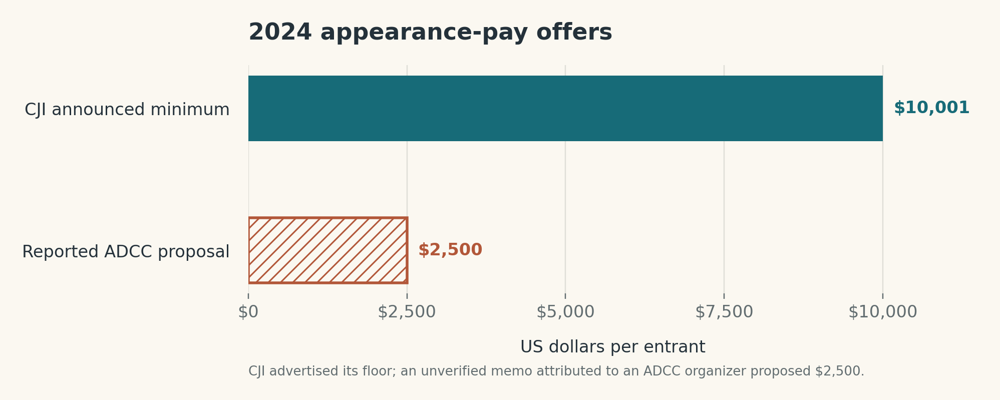
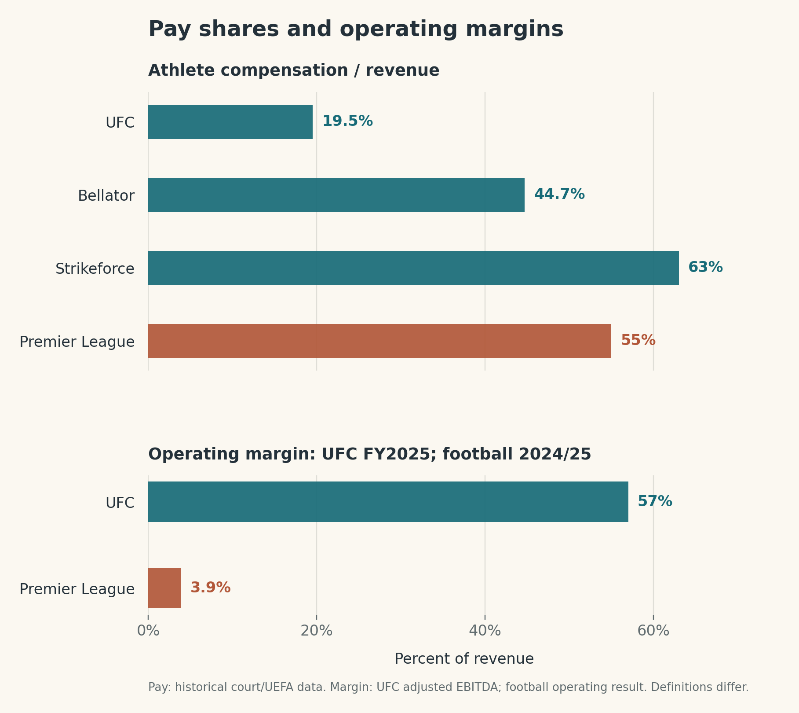
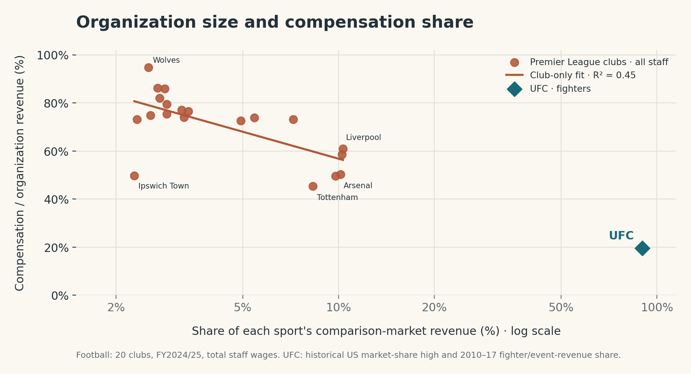
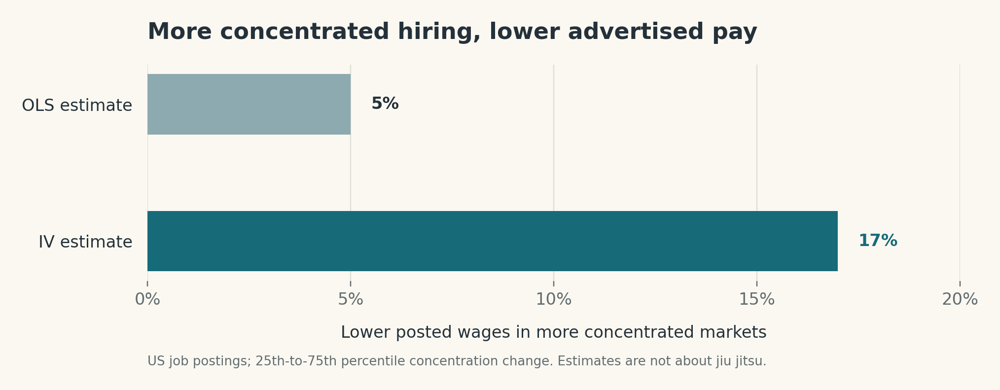
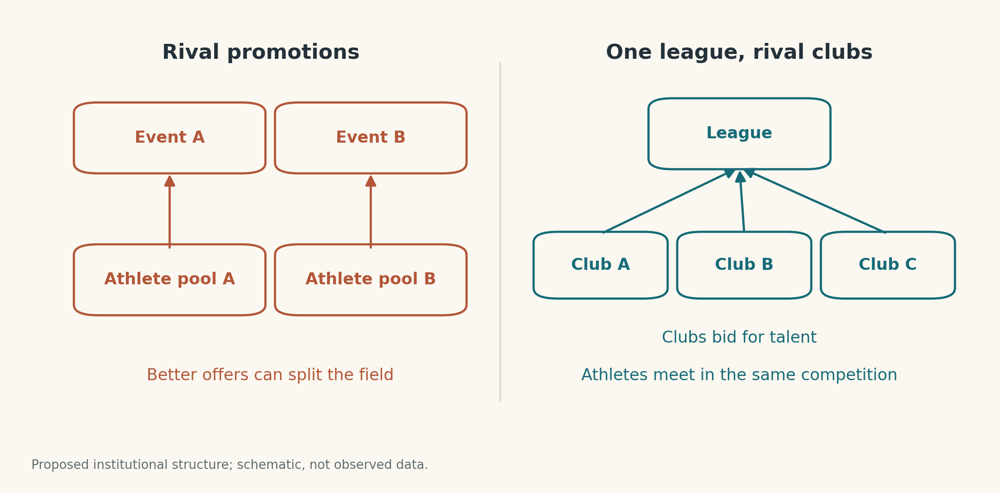

# Jiu Jitsu and Monopsony

In 2024, Craig Jones complained that the people playing drums at ADCC were being paid more than the athletes. I do not know the drummers' fee, so I take this as [Jones's complaint](https://www.reddit.com/r/bjj/comments/1bu6ea8/did_craig_jones_make_a_decision_on_adcc/), rather than an audited comparison. Still, the joke points to a serious question: how does a sport built around its competitors end up paying many of them so little to compete?

Jones's answer was to create the Craig Jones Invitational (CJI). In an [interview before the 2024 event](https://lexfridman.com/craig-jones-2-transcript/), he said that ADCC paid $10,000 to a men's division winner, while CJI would pay every entrant $10,001 just to appear and $1 million to win a division. He also said ADCC subsequently raised its women's winner prize to match the men's and began offering some athletes appearance money. The latter claims are Jones's account of ADCC's response; I have not found a complete, independently verified list of what ADCC eventually paid each athlete.

*Figure 1: CJI's $10,001 appearance minimum was [announced by Jones](https://lexfridman.com/craig-jones-2-transcript/). The hatched $2,500 ADCC figure is a **proposal**, discussed in a [voice memo shared by Jones](https://www.instagram.com/reel/C8Fl3Qxua3k/); it is not a verified payment. The chart compares appearance offers, not tournament prizes.*

CJI gave athletes a better outside option. It also ran on [16–17 August 2024](https://fightfoundation.com/), overlapping the [ADCC world championship on 17–18 August](https://adcombat.com/adcc-worlds-2024-schedule/). Fans had to watch two fields of elite grapplers instead of one. This is the puzzle I care about: **can one competition bring the best athletes together without giving any one employer outsized bargaining power?**

## The labour market behind the spectacle

Jiu jitsu's identity as a martial art may help explain why promoter-run events became its familiar professional format. [ADCC's account of its origins](https://adcombat.com/about-abu-dhabi-combat-club/) says its founder became interested in MMA after watching the first UFC, studied Brazilian jiu jitsu, and created a submission-grappling tournament in 1998. That is one event's history, not proof that the whole sport copied MMA. It does show how easily a promoter-led event can feel like the natural way to present a martial art.

But being a martial art does not mean jiu jitsu has to compete like MMA. [ADCC describes grappling as competition without strikes](https://adcombat.com/about-abu-dhabi-combat-club/), a relevant difference when considering how often athletes could compete. A shared competition could arrange recurring fixtures while independent clubs hire the athletes. Whether a weekly schedule would be safe is a separate question.

The current event model puts both decisions largely in one organizer's hands. A promoter assembles the matchups, builds the audience, and negotiates with athletes; access to that audience may depend on accepting its offer. Existing gyms and teams are not usually competing employers in a shared professional season. That difference matters for bargaining power.

The UFC and football provide a suggestive comparison. In a [US court's 2023 class-certification order](https://www.uschamber.com/assets/documents/Lower-Court-Order-Le-v.-Zuffa-LLC-D.-Nev.pdf), UFC compensation for the relevant fighters was about **19.5% of event revenue** over 2010–17. [UEFA's figures](https://editorial.uefa.com/resources/027e-1747424ecde1-af32c4128081-1000/ecfl_bm_report_2022_low_resolution_.pdf) put Premier League **player wages at 55% of club revenue** in financial year 2021. These are different years and different revenue definitions; they cannot tell us what a jiu jitsu league would pay. They do make it worth asking who bargains over the money a sport generates.

The profitability figures sharpen the question. [TKO reported](https://investor.tkogrp.com/news/news-details/2026/TKO-Reports-Fourth-Quarter-and-Full-Year-2025-Results/) a **57% adjusted EBITDA margin** for its UFC segment in 2025. [Deloitte reported](https://www.deloitte.com/content/dam/assets-zone2/uk/en/docs/services/consulting/2026/deloitte-annual-review-of-football-finance-2026.pdf) £263 million of operating profit on about £6.8 billion of Premier League club revenue in 2024/25: roughly **3.9%**. These are *different accounting measures*, and neither is net profit. UFC's segment measure excludes some corporate costs; Deloitte's operating result excludes player trading and certain exceptional items. Nor are the margins from the same years as the athlete-pay shares above. The gap is striking, but it cannot by itself establish that one structure causes lower athlete pay.

*Figure 2: The upper panel uses the [UFC class-certification order](https://www.uschamber.com/assets/documents/Lower-Court-Order-Le-v.-Zuffa-LLC-D.-Nev.pdf): UFC 19.5% of **event** revenue paid to the relevant fighters in 2010–17, Bellator about 44.7% of revenue in 2010–15, and Strikeforce about 63% in 2009–10. [UEFA](https://editorial.uefa.com/resources/027e-1747424ecde1-af32c4128081-1000/ecfl_bm_report_2022_low_resolution_.pdf) reports a 55% player wage share of Premier League club revenue in FY2021. The lower panel uses [TKO's](https://investor.tkogrp.com/news/news-details/2026/TKO-Reports-Fourth-Quarter-and-Full-Year-2025-Results/) FY2025 UFC segment adjusted EBITDA margin and [Deloitte's](https://www.deloitte.com/content/dam/assets-zone2/uk/en/docs/services/consulting/2026/deloitte-annual-review-of-football-finance-2026.pdf) 2024/25 Premier League operating result divided by revenue. The panels use different periods and accounting definitions and should not be added together. The court accepted the MMA pay comparisons as possible damages benchmarks at class certification; it did not determine final liability.*

The Bellator and Strikeforce numbers matter as much as the UFC–football gap. They were promoter-run MMA organizations too, yet the court record reports much larger fighter shares. We should therefore be careful about blaming the *promotion format alone*. What matters is how easily athletes can take their services to another buyer with a similar audience. The comparison suggests that a promoter can face meaningful bargaining pressure when competitors have credible alternatives.

I also wanted to see whether larger organizations pay a smaller share. [Deloitte's 2024/25 accounts](https://www.deloitte.com/content/dam/assets-zone2/uk/en/docs/services/consulting/2026/deloitte-annual-review-of-football-finance-2026.pdf) give revenue and wage costs for each of the 20 Premier League clubs. The fitted line slopes downward: clubs with more revenue generally spent a *smaller* fraction on wages in this one season. These are **total staff wages**, not player wages, and the ratio puts revenue in both axes. Club size can also reflect commercial income and sporting success. The line describes the accounts; it is not an estimate of monopsony power.

*Figure 3: Rust points are all 20 Premier League clubs in [Deloitte's 2024/25 table](https://www.deloitte.com/content/dam/assets-zone2/uk/en/docs/services/consulting/2026/deloitte-annual-review-of-football-finance-2026.pdf). A club's size is its revenue divided by the 20-club total; its pay share is **all staff** costs divided by its revenue. The line fits pay share to the logarithm of club revenue share, using clubs only ($R^2=0.45$). The teal UFC point combines the [court record's](https://www.uschamber.com/assets/documents/Lower-Court-Order-Le-v.-Zuffa-LLC-D.-Nev.pdf) roughly 90% reported high for revenue share in the historical **US elite MMA promotion market** with a 19.5% fighter share of **event revenue** in 2010–17. Those UFC measures are not paired observations from one year. The sports, revenue definitions, and wage measures differ, so the spacing between UFC and the clubs is descriptive, not an estimate of the effect of market power.*

The [court record](https://www.uschamber.com/assets/documents/Lower-Court-Order-Le-v.-Zuffa-LLC-D.-Nev.pdf) gives a more concrete reason to ask whether the UFC benefited from controlling both employment and matchmaking. During the case period, the people who negotiated most fighter contracts also chose pairings and bout timing; the contracts included exclusivity and rights to match rival offers. Such terms can make a rival's offer less effective even when that rival exists.

The more direct MMA test is also in that [court record](https://www.uschamber.com/assets/documents/Lower-Court-Order-Le-v.-Zuffa-LLC-D.-Nev.pdf): an expert related UFC fighters' share of event revenue to the share of fighter services allegedly foreclosed to rival promoters. The reported relationship was negative after controls. That finding was reviewed at the class-certification stage, not a final ruling on liability. It asks a better question than whether organizations in two different sports happen to sit on one pooled regression line.

Economists call the employer's power to set pay below what it would need to offer in a more competitive labour market *monopsony power*. The name can mislead: there need not be literally one employer. Alan Manning asked whether a tiny wage cut would really make every worker immediately leave, and used that observation in [*Monopsony in Motion*](https://personal.lse.ac.uk/manning/work/book.html). In his later essay [*Who Set Your Wage?*](https://paulgp.github.io/speeches/card_2022_aea.pdf), David Card called Manning's book a landmark and described a growing consensus that firms have some wage-setting power. The debate is about how much power they have, where it comes from, and what institutions constrain it.

Here is the mechanism in jiu jitsu. If an athlete values the prestige and audience of one event, a smaller event may be an imperfect substitute even when it offers some money. The prestigious organizer then knows that a lower offer will not necessarily send the athlete elsewhere. Some of the value the athlete helps create can stay with the organizer. A competing offer changes that calculation: the athlete can credibly leave, so keeping them becomes more expensive.

There is evidence for this mechanism outside sport. Using US online job postings, [Azar, Marinescu, and Steinbaum](https://marshallsteinbaum.org/wp-content/uploads/2024/09/azar-marinescu-steinbaum-2020-labor-market-concentration-jhr-accepted-version-.pdf) find that moving from the 25th to the 75th percentile of employer concentration is associated with **5% lower posted wages** in their ordinary least-squares estimate and **17% lower** in their instrumental-variables estimate. These are estimates for selected occupations on one job board, and the authors discuss limits to their identification. They show why employer concentration is relevant to wage setting; they do not measure monopsony power in jiu jitsu.

*Figure 4: Estimates from [Azar, Marinescu, and Steinbaum](https://marshallsteinbaum.org/wp-content/uploads/2024/09/azar-marinescu-steinbaum-2020-labor-market-concentration-jhr-accepted-version-.pdf) for a move from the 25th to the 75th percentile of hiring concentration. OLS is the regression estimate; IV uses an instrument to address some sources of bias. Neither bar is an estimate for grapplers.*

CJI's offer fits this story: an outside option appeared, and Jones reports that ADCC improved some offers. But the two events also show why adding competing *events* is an awkward long-run answer. Each organizer needs its own field of athletes. A fan who wants to see the best competitors meet may lose that matchup even as the athletes gain a better bargaining position.

## Competing clubs, one competition

Jiu jitsu could instead organize professional competition more like football: clubs hire athletes and bid to attract talent, while the clubs meet in one shared league. The league would arrange the fixtures; a club would have reason to pay well enough to assemble a strong roster. The same audience could watch those rosters compete against one another. The clubs must be free to make genuinely competing pay offers; a league-wide wage cap would weaken the mechanism. A club-versus-club night across several weight classes is one possible format, but the economic point is the separation of *who employs athletes* from *who runs the competition*.

*Figure 5: The proposal. Rival clubs could compete to hire athletes while a shared league brings those athletes into the same competition. This is an institutional sketch, not a measured outcome.*

Regular fixtures seem conceivable because [ADCC already schedules several grappling bouts for competitors across a weekend](https://adcombat.com/adcc-worlds-2024-brackets-released/). That is different from saying weekly competition would be safe for every athlete; a real league would have to design its schedule around injury and recovery. Nor would the idea require inventing jiu jitsu teams: [CJI's 2025 event already used a team tournament](https://www.cji2.com/). The proposed change is to make clubs independent, recurring buyers of athletes' services inside a common season.

I do not know whether such a league would succeed commercially. But the 2024 pay dispute shows the trade-off clearly. CJI made athletes harder to underpay by giving them somewhere else to go; the simultaneous events split the field. A shared league with competing clubs is one way to try to keep the first effect without accepting the second.
